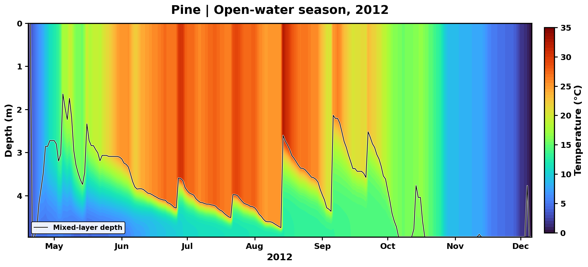

# FLake Explorer — A Python implementation of FLake

Explore lake temperature, mixing, snow and ice in your browser. Select a lake on the Minnesota map, choose a climate scenario, adjust the model settings and run a simulation.

## Start a simulation

1. Open the notebook in Colab and run its two code cells.
2. Find a lake by name, county or ID, or click its point on the map.
3. Choose an SSP. Keep the supplied lake settings for a first run, or change the depth, fetch, optical properties, initial state and snow/sediment options.
4. Click **Run simulation**. View annual responses, choose an open-water year or winter, and download the experiment.

The opening example is **Riley**, with a recorded mean depth of **6.17 m**. You can choose any of the 1,925 available lakes. No local Python installation is needed.

## Coverage

| Item | Included |
|---|---|
| Lake catalogue | 1,925 Minnesota production lakes |
| Climate forcing | GFDL-ESM4, NEX-GDDP-CMIP6 |
| Historical baseline | 1995–2014 |
| Projections | 2015–2099 |
| Scenarios | SSP1-2.6, SSP2-4.5, SSP3-7.0 and SSP5-8.5 |
| Warm-up inputs | 1950–1994, using the selected experiment settings |
| Calendar | 365 days per year; February 29 omitted |

The complete forcing dataset is approximately **7.19 GiB**, stored as **78 release bundles**. Only the selected lake's required bundles are downloaded and cached. A first run usually needs two bundles, approximately 200 MiB in total; it does not download the full catalogue. Switching scenarios or lakes may require another bundle. On MSI, the same interface can read the existing local export.

## One setup, three views

**Annual response:** open-water mean mixed-layer temperature, open-water duration, ice-on and ice-off. Choose absolute values or changes from the same experiment's 1995–2014 baseline. Ice-event dates remain undefined in winters without persistent ice. The figure shows near-, mid- and end-century shading and Sen’s slopes for 2015–2099.

**Thermal structure:** choose a year to show the temperature–depth section during its longest continuous ice-free interval. The thin line marks mixed-layer depth. The vertical field follows FLake's assumed bulk profile; it is not an independent simulation at every plotted depth.

**Snow and ice:** choose a complete winter. Snow appears above the interface and ice extends downward. The plotting window follows the cover season rather than leaving months of empty space.

Changing a scientific setting requires a new run. Changing a plot year redraws the existing result. Identical experiment settings reuse the session's cached computation; SSP branches share a historical run only when every scientific setting agrees.

*Illustrative output from Pine's recorded historical inputs; Riley is the opening lake in the interface.*

## Definitions

- Open-water mean temperature uses **all** days with modeled ice thickness below 1 cm in each complete calendar year.
- Open-water duration counts all such days, including separated ice-free intervals. It is not the length of only the plotted summer interval.
- Ice dates require three consecutive days at or above 1 cm; final breakup requires a persistent below-threshold interval after the last persistent ice run. Winters span July–June and are labeled by their **ending year**. Missing events are undefined, not zero dates.
- Date changes use a continuous noleap seasonal coordinate, so December and January events do not wrap across the year boundary.

Initial-condition controls apply on **1 January 1950**. The model warms up through 1994 before displaying results from 1995. Parameter experiments use their selected settings during warm-up and do not reuse an incompatible saved production state. Historical integration continues through 2014, and each SSP starts from its complete end-2014 state.

## Model and inputs

FLake represents a one-dimensional, two-layer water column, prognostic snow and ice, and optional bottom-sediment heat exchange. The physics engine and daily integration loop are preserved from the verified implementation. Snow off gives bare-ice thermodynamics; it does not turn off lake ice.

Required daily inputs are incoming shortwave and longwave radiation (W m⁻²), air temperature (°C), vapor pressure (mb), wind speed (m s⁻¹), raw partitioned snowfall (kg m⁻² s⁻¹), and light extinction (m⁻¹). Native incoming longwave is supplied directly. The example's snowfall is already partitioned; snow retention is applied once within the runner. The supplied daily optical values are preserved. A constant light-extinction value is an explicit alternative experiment.

Defaults include snow/ice albedo endpoints 0.60/0.10, minimum snow conductivity 0.30 W m⁻¹ K⁻¹, snow-density coefficient 2000 and an active sediment module. Lake-specific physical parameters are loaded from the catalogue. Initial sediment temperature and the prescribed lower-boundary temperature are separate controls.

## Code guide

| File | Purpose |
|---|---|
| `Run_FLake.ipynb` | Colab setup and dashboard launch |
| `flake/dashboard.py` | Lake selection, linked map and controls |
| `flake/configuration.py` | Physical settings and independent initial states |
| `flake/experiments.py` | Warm-up, baseline, SSP continuation and caching |
| `flake/data_access.py` | Checksum-verified downloads and lossless inputs |
| `flake/model.py` | Preserved daily integration loop |
| `flake/physics.py` | Preserved FLake physics and original source notices |
| `flake/indicators.py` | Annual metrics and seasonal ice dates |
| `flake/profiles.py` | Preserved FLake temperature-profile reconstruction |
| `flake/annual_plot.py`, `flake/plotting.py` | Annual and seasonal figures |
| `flake/downloads.py` | Settings, daily output, annual metrics and figures |

## Verification and attribution

The century input export passed all **9,625 lake/period cases**. Numerical comparisons against production passed **60 cases for 12 representative lakes**, including full historical and four future integrations through 2099. Ice classifications were identical. Snow-off, sediment-off and parameter-customization checks passed. These representative checks do not assert that every lake has been rerun or validate the model against observations. The new interface and experiment wrapper have additional checks described in [verification](verification/README.md).

FLake was developed by **Dmitrii Mironov and collaborators at the German Weather Service (DWD)**. Original code-owner notices remain in the physics source. Reference: Mironov (2008), *Parameterization of Lakes in Numerical Weather Prediction. Description of a Lake Model*, COSMO Technical Report 11, [doi:10.5676/DWD_pub/nwv/cosmo-tr_11](https://doi.org/10.5676/DWD_pub/nwv/cosmo-tr_11). See [NOTICE.md](NOTICE.md) and [CITATION.cff](CITATION.cff) for model, data and companion-study attribution.

For input details and experiments, see [the user guide](docs/USER_GUIDE.md). For release uploads and updating the notebook, see [maintaining this repository](docs/MAINTAINING.md).
